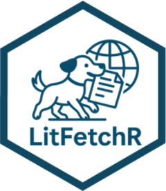

# LitFetchR 

<!-- badges: start -->
<!-- badges: end -->

The purpose of `LitFetchR` is to automatically retrieve and deduplicate
references based on saved search string(s). Access to Web of Science and
Scopus requires personal API keys, while PubMed can be queried without
one.

## What it does

`LitFetchR` follows three steps, from the first search string to the
maintenance of a living review:

1.  **Search:** `create_save_search()` runs a candidate search string on
    PubMed, Scopus and Web of Science at once, returns the number of
    results on each platform, and saves the search strings you choose to
    a text file.
2.  **Fetch:** `manual_fetch()` retrieves the references on demand, and
    `auto_LitFetchR_setup()` schedules the same retrieval at a daily,
    weekly or monthly frequency. Only references that were not retrieved
    in a previous run are returned.
3.  **Deduplicate:** the references of the different platforms can be
    merged and deduplicated (optional, see below).

Every run, manual or scheduled, is recorded in a run log (`run_log.csv`)
with the search string, the exact query sent to each platform, the
number of results, the status of each platform and any error.

## Installation

Install the released version of `LitFetchR` from
[CRAN](https://cran.r-project.org/package=LitFetchR):

``` r
install.packages("LitFetchR")
```

Or install the development version from [GitHub](https://github.com/)
using `devtools` or `remotes`:

``` r
#install via devtools
install.packages("devtools")
devtools::install_github("thomasdumond/LitFetchR")

#install via remotes
install.packages("remotes")
remotes::install_github("thomasdumond/LitFetchR")
```

### Optional packages

- **Deduplication** (`dedup = TRUE` or `dedup_refs()`) uses the package
  `ASySD`, which is not on CRAN:

``` r
install.packages("remotes")
remotes::install_github("camaradesuk/ASySD")
```

- **Scheduling on macOS and Linux** uses the package `cronR`:

``` r
install.packages("cronR")
```

On Windows, scheduling uses the Windows Task Scheduler and needs no
additional package.

## Tutorial

You can find all the tutorials in the
[Articles](https://thomasdumond.github.io/LitFetchR/articles/) tab.

## Requirements

This package uses APIs to access Web of Science and Scopus platforms. To
enjoy the full performance of `LitFetchR`, request personal API keys
from the platforms. For more information on API keys, you can see our
tutorial [Get API
keys](https://thomasdumond.github.io/LitFetchR/articles/Get_API_keys.html).
If you are affiliated with a university we suggest contacting your local
librarian to discuss the use of API keys (i.e. quota access, details of
databases accessed through Web of Science).

PubMed does not require API key access, so the package can still be used
to access PubMed only.

*More scientific platforms and databases will be considered for
inclusion in future versions of the package.*

## Getting help and contributing

`LitFetchR` is open source. Please report bugs, ask questions or suggest
new features by opening an
[issue](https://github.com/thomasdumond/LitFetchR/issues). Contributions
to the code and the documentation are welcome by forking the repository
and submitting a pull request.

## Citation

To cite `LitFetchR` in publications, use:

``` r
citation("LitFetchR")
```
